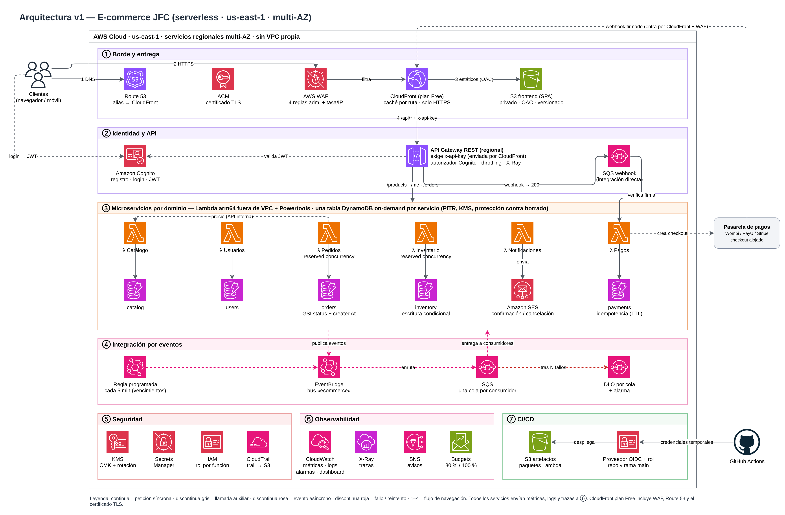

# E-commerce JFC en AWS — Arquitectura serverless v1

Prueba técnica para el cargo de **Analista CloudOps AWS**.

JFC necesita poner en producción un e-commerce de tres capas con tráfico variable (valles de pocos cientos de usuarios y picos de varios miles). La propuesta es una arquitectura **100 % serverless y administrada**, multi-AZ en `us-east-1`, que paga por uso, absorbe los picos en el borde y procesa la compra por eventos.



## Entregables

| Entregable | Archivo | Estado |
|---|---|---|
| Documento de arquitectura | [PDF](docs/Documento-Arquitectura-JFC-v1.pdf) · [Word](docs/Documento-Arquitectura-JFC-v1.docx) | ✅ Listo |
| Diagrama de arquitectura general | [PNG](docs/diagramas/01-arquitectura-general-v1.png) · [draw.io](docs/diagramas/01-arquitectura-general-v1.drawio) | ✅ Listo |
| Flujo de compra por eventos | [PNG](docs/diagramas/02-flujo-compra-eventos-v1.png) · [draw.io](docs/diagramas/02-flujo-compra-eventos-v1.drawio) | ✅ Listo |
| Pipeline de CI/CD | [PNG](docs/diagramas/03-pipeline-cicd-v1.png) · [draw.io](docs/diagramas/03-pipeline-cicd-v1.drawio) | ✅ Diseño listo |
| Infraestructura como código (Terraform) | [`infra/`](infra/) | 🟡 Módulo `edge` listo (CloudFront, S3, WAF) con entornos `dev`/`prod` y pruebas; resto en construcción |
| Estimación de costos (Calculadora de AWS) | [`docs/costos/`](docs/costos/) | 🚧 En construcción |

> Los archivos `.drawio` se abren y editan en [diagrams.net](https://app.diagrams.net) o con la extensión de draw.io para VS Code.

## Resumen de la solución

- **Pago por uso:** Lambda, API Gateway, DynamoDB on-demand, SQS y EventBridge cobran por petición. Sin servidores, NAT Gateways ni bases de datos encendidas 24/7.
- **El borde absorbe el pico:** CloudFront sirve desde caché el catálogo (~90 % del tráfico) y AWS WAF filtra bots y ataques.
- **Compra asíncrona y a prueba de fallos:** el checkout responde 202 y sigue por eventos (EventBridge + SQS) con reintentos, DLQ, idempotencia y escrituras condicionales que evitan la sobreventa.
- **Seguridad por capas:** WAF, Cognito, IAM de mínimo privilegio por función, KMS, Secrets Manager, S3 privado con OAC, origen de la API protegido y pasarela de pagos externa (la tarjeta nunca toca JFC).
- **Observabilidad:** logs estructurados, métricas, trazas con X-Ray, alarmas por correo y un dashboard único.
- **CI/CD:** GitHub Actions con OIDC (sin llaves guardadas), aprobación manual para producción y rollback por alias de Lambda.

## Cómo se cumple cada requisito de la prueba

| Requisito | Cómo se cumple | Sección del documento |
|---|---|---|
| Diagrama de arquitectura (obligatorio) | Tres diagramas con íconos oficiales de AWS | 3, 5, 9 |
| IaC reutilizable | Terraform modular con entornos `dev` y `prod` por variables | 10.2 |
| Costos / pagar solo lo consumido | Servicios por uso; costos fijos mínimos y explícitos | 10.1 |
| Picos y solicitudes simultáneas | Caché en el borde, Lambda y DynamoDB on-demand, SQS como colchón, throttling | 6.1 – 6.4 |
| Sistema de caché | Navegador, CloudFront (con `stale-if-error`) y memoria de Lambda | 6.3 |
| Disponibilidad permanente | Servicios multi-AZ administrados, reintentos, DLQ, PITR | 6.5 |
| Base de datos confiable y escalable | DynamoDB on-demand en 3 AZ, PITR, KMS, escrituras condicionales | 6.2 |
| Observabilidad | CloudWatch, X-Ray, alarmas con SNS, dashboard | 8 |
| Mínima gestión manual | Sin servidores ni VPC; despliegue por pipeline | 3, 9 |
| Seguridad de datos y transacciones | WAF, Cognito, IAM, KMS, Secrets Manager, OAC, checkout alojado | 7 |
| CI/CD (opcional) | GitHub Actions + OIDC | 9 |

## Estructura del repositorio

```
.
├── docs/
│   ├── Documento-Arquitectura-JFC-v1.pdf
│   ├── Documento-Arquitectura-JFC-v1.docx
│   ├── diagramas/        # PNG + .drawio editables
│   └── costos/           # Calculadora de AWS (en construcción)
└── infra/                # Terraform: modules/edge + envs/dev y envs/prod
```

## Evolución (v2)

La v1 evoluciona cuando las métricas lo justifican: ECS Fargate con tráfico alto sostenido, Aurora Serverless v2 para reportes relacionales, ElastiCache para lecturas calientes, Step Functions si el flujo de compra crece y multi-región para recuperación ante una caída regional. Detalle en la sección 11 del documento.
